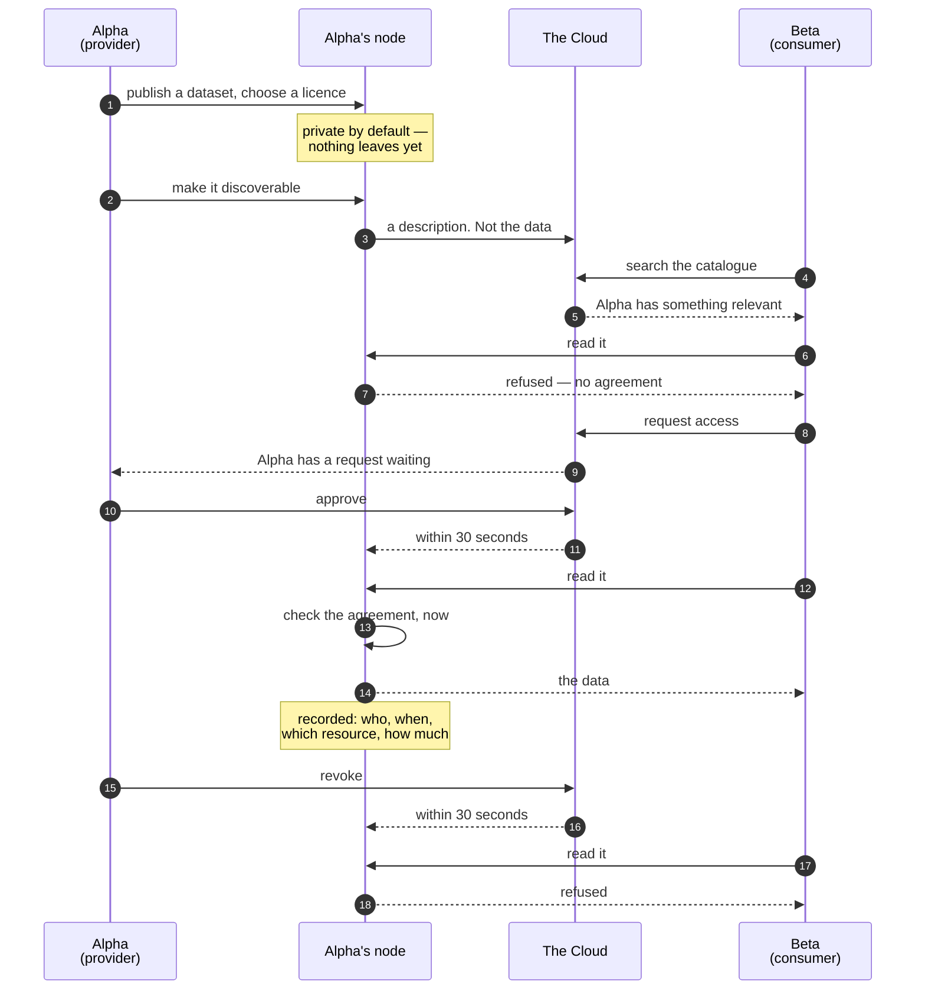
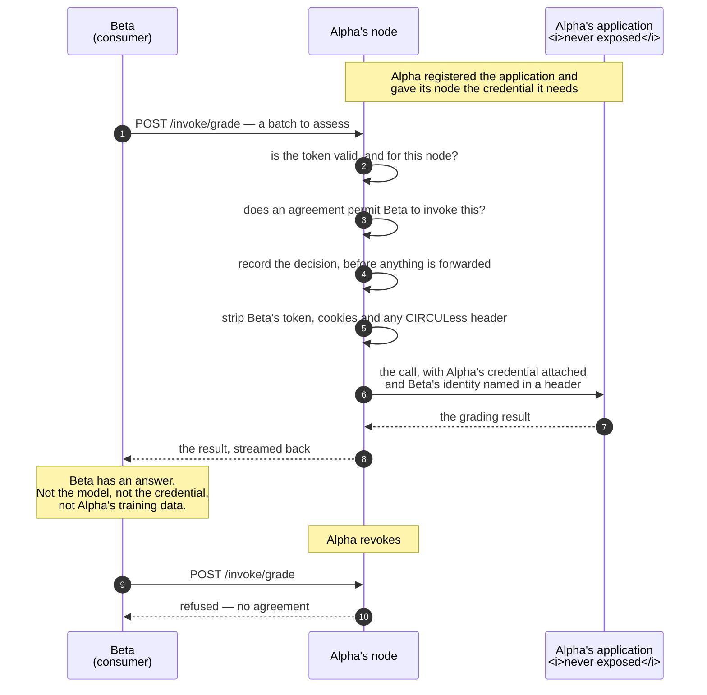

# How sharing works

Two walkthroughs, from the moment something is published to the moment access is
withdrawn. Two organisations throughout: **Alpha**, who owns the thing, and **Beta**, who
wants to use it.

The first follows a **dataset**, because it is the simpler shape and shows the agreement
machinery plainly. The second follows a **service**, which is what most partners will
actually offer.

## Sharing a dataset

### What happens at each step

**Publishing.** Alpha registers a dataset on their node and gives it a licence. At this
point it is private: invisible to anyone outside Alpha, and absent from the catalogue.
Making it discoverable is a separate, deliberate act.

**The description crosses, the data does not.** Alpha's node sends the Cloud a
description — what the dataset covers, its licence, where in the value chain it sits, and
which node holds it. The Cloud never receives the dataset.

**Beta finds it.** Beta searches the catalogue and sees the description. Being able to
see that something exists is not permission to read it, which is why the next step
happens at all.

**Beta tries, and is refused.** Worth showing because it is the normal case. Alpha's node
checks for an agreement, finds none, and refuses — saying *why*, so Beta knows to ask
rather than wondering whether something is broken.

**Beta requests access.** Naming the resource and what they want to do with it. Beta's
organisation is taken from who Beta is, not from what Beta types — you cannot request
access on behalf of an organisation you do not belong to.

**Alpha decides.** Only an administrator of Alpha can approve a request for Alpha's data.
Not Bavenir, not a platform operator, not an administrator of any other organisation.
Approval, refusal and revocation are all recorded with who did it and when.

**Beta reads.** Alpha's node checks the agreement **at the moment of the request** —
every request, not once at the start. It records who read what, when, and how much.

**Alpha revokes.** Reads stop — the next request is refused. Beta's copy of anything
already downloaded is still Beta's; revocation ends access, it does not reach into
Beta's storage. This is the one place where a dataset is weaker than a service.

## Calling a service

Now the shape most partners will use. Alpha runs a grading model; Beta wants to grade a
batch. Nothing about the model, and nothing about Alpha's credential for it, ever reaches
Beta.

### What is different from a dataset

**The caller ends up with an answer.** That is the whole point. Beta learns what Alpha's
model concluded about Beta's batch; Beta does not learn how it concluded it.

**Alpha's credential never leaves Alpha's node.** The node holds it encrypted, attaches it
on the way out, and returns it to nobody. Beta cannot call the application directly even
if they discover its address — the application accepts traffic from the node only.

**Beta cannot pretend to be someone else.** The node strips every `X-CIRCULess-*` header
the caller sent before adding its own, so an identity in the forwarded request is one the
node put there.

**Withdrawal is complete.** Revoke the agreement and the next call is refused. Beta holds
nothing that keeps working — which is the difference from a file, and the reason a service
is usually the better thing to offer.

**The application does not know any of this is happening.** It receives an ordinary HTTP
request with its own credential on it. No CIRCULess-specific code, no library, no change.

## Variations on the same shape

**Alpha can offer first.** A provider can offer access without being asked; Beta then
accepts. Same agreement, started from the other end.

**It can be an application rather than a person.** An application belonging to Beta can
read under the same agreement, and is recorded as itself rather than as a person.

**Someone can belong to two organisations.** A consultant working for both must say which
one they are acting for when it could be either, and the record shows which.

## The two things worth taking away

**The decision is always made by the provider's node.** Not by the Cloud, not by the
network, not by the gateway, and not once at the start. Alpha's software decides each
request about Alpha's service or data, every time, against the agreements it holds — and
it keeps deciding correctly even when the Cloud is unreachable.

**Everything is recorded on both sides.** Alpha can see every call and every read,
allowed and refused. Both organisations can see every change to the agreement. The
records cannot be edited or deleted, which is what makes them worth having.

---

Next: [how your data is protected](security-measures.md) — the controls behind all of
this, and the limits of the beta.
