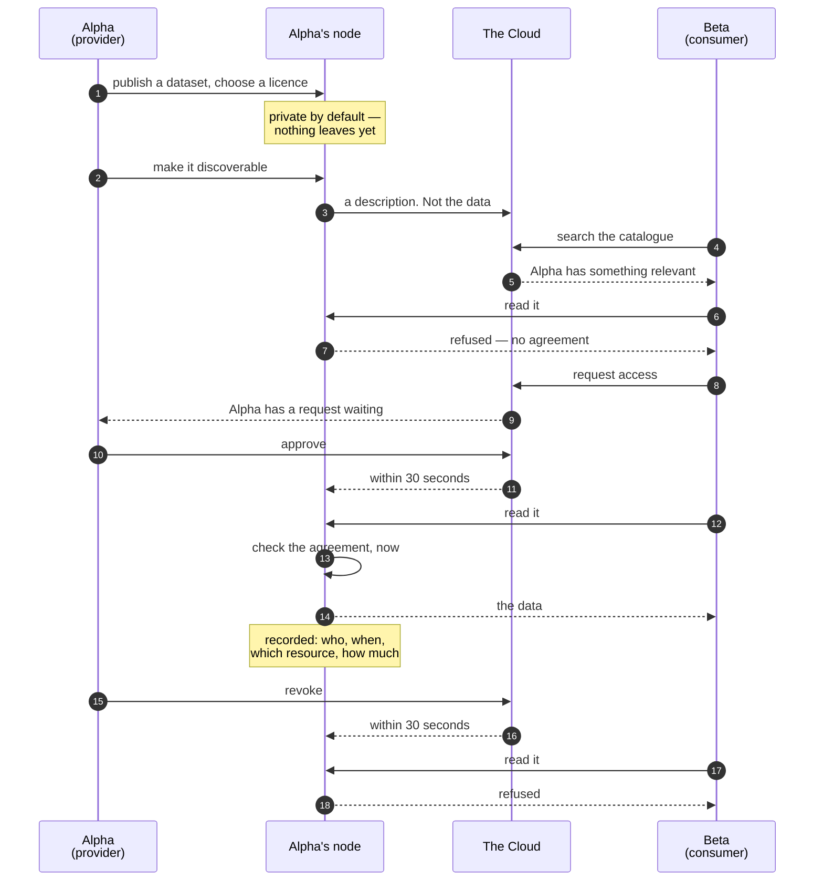

# How data gets shared

One dataset, from the moment it is published to the moment access is withdrawn. Two
organisations: **Alpha**, who has the data, and **Beta**, who wants it.

## What happens at each step

**Publishing.** Alpha registers a dataset on their node and gives it a licence. At this
point it is private: invisible to anyone outside Alpha, and absent from the catalogue.
Making it discoverable is a separate, deliberate act.

**The description crosses, the data does not.** Alpha's node sends the Cloud a
description — what the dataset covers, its licence, where in the value chain it sits, and
which node holds it. The Cloud never receives the dataset.

**Beta finds it.** Beta searches the catalogue and sees the description. Being able to
see that something exists is not permission to read it, which is why the next step
happens at all.

**Beta tries, and is refused.** Worth showing because it is the normal case. Alpha's node
checks for an agreement, finds none, and refuses — saying *why*, so Beta knows to ask
rather than wondering whether something is broken.

**Beta requests access.** Naming the resource and what they want to do with it. Beta's
organisation is taken from who Beta is, not from what Beta types — you cannot request
access on behalf of an organisation you do not belong to.

**Alpha decides.** Only an administrator of Alpha can approve a request for Alpha's data.
Not Bavenir, not a platform operator, not an administrator of any other organisation.
Approval, refusal and revocation are all recorded with who did it and when.

**Beta reads.** Alpha's node checks the agreement **at the moment of the request** —
every request, not once at the start. It records who read what, when, and how much.

**Alpha revokes.** Reads stop. The node learns within about thirty seconds, plus up to
five minutes for a key already issued to expire — so call it well under ten minutes from
the decision to the last possible read.

## The three things worth taking away

**The decision is always made by the provider's node.** Not by the Cloud, not by the
network, not by the gateway, and not once at the start. Alpha's software decides each
request about Alpha's data.

**Withdrawal actually works.** Because nobody was given a copy, revoking is not a
request that someone delete something. It is simply the end of access.

**Everything is recorded on both sides.** Alpha can see every read of their data,
allowed and refused. Both organisations can see every change to the agreement. The
records cannot be edited or deleted — that is what makes them worth having.

## Variations on the same shape

**Alpha can offer first.** A provider can offer access without being asked; Beta then
accepts. Same agreement, started from the other end.

**It can be an application rather than a person.** An application belonging to Beta can
read under the same agreement, and is recorded as itself rather than as a person.

**It can be a service instead of a dataset.** Instead of reading a file, Beta calls one
of Alpha's applications through Alpha's node. The same agreement check happens first, and
Alpha's credential is attached by the node — Beta never sees it and never reaches the
application directly.

**Someone can belong to two organisations.** A consultant working for both must say which
one they are acting for when it could be either, and the record shows which.

---

Next: [who runs what](who-runs-what.md) — and who is responsible for it.
