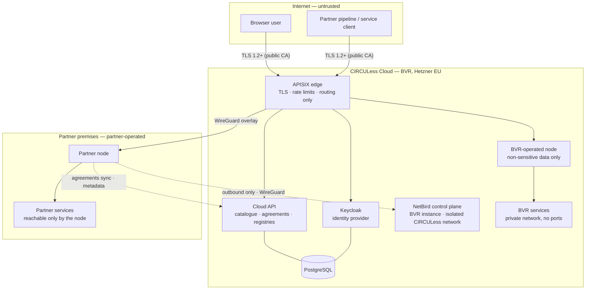

# CIRCULess core platform — Security measures

**Version:** 1.0 · 24 Sep 2026 · **Audience:** technical staff of CIRCULess partners, service owners, the T2.7 auditors
**Status:** describes the beta (TRL 5) as designed and decided. The measures are built during the October milestones and verified in the security validation in early November, before the T2.7 audit (§14).

**Sources:** `D2.1_requirements.md` (the beta requirement set), `security_requirements.md` (the TRL 5 security requirements, `SR-` numbers), `security_requirements_review.md` (conflicts, decisions and the validation plan). Terms are defined in `12_glossary.md`.

---

## 1. Summary

The CIRCULess core platform — the CIRCULess Cloud and the CIRCULess Nodes — lets organisations publish data and services, agree access, and exchange them. Its security rests on six choices:

1. **The provider's node decides.** Every request for data or a service is decided by the node that holds it, locally, and recorded. The Cloud, the gateway and the network never grant access on their own.
2. **Short, narrow tokens.** Access tokens live five minutes and are valid at one node only. Revoking an agreement takes effect within about 30 seconds, plus at most those five minutes.
3. **No shared secrets.** Nodes and service clients authenticate with private keys that never leave their machines. No passwords or client secrets are exchanged, and none are stored in git.
4. **No open ports at partner sites.** Partner nodes connect outwards to an encrypted WireGuard overlay. Nothing on a partner's premises has to be reachable from the internet.
5. **No anonymous access.** Every endpoint, the catalogue included, requires a valid token. The only exceptions are the identity provider's protocol endpoints, which the protocol requires to be open.
6. **Sensitive data stays home.** BVR infrastructure stores only non-sensitive partner data, and BVR-operated nodes refuse data classified as sensitive. Sensitive data stays on the partner's own node.

The platform is built from open-source components: Keycloak, Apache APISIX, NetBird / WireGuard, PostgreSQL, SQLite, FastAPI, Restic, Uptime Kuma, Grafana, Loki and Prometheus, all hosted in the EU on Hetzner.

---

## 2. Architecture and trust boundaries

| Boundary | Crossed by | Protected by |
|---|---|---|
| Internet → Cloud edge | Browsers, pipelines, service clients | TLS 1.2+ with public-CA certificates, HSTS, rate limits, a declared port list |
| Edge → node | Forwarded requests | WireGuard overlay; the node validates every token itself |
| Node → Cloud | Metadata publication, agreement sync | WireGuard; the node's own signed client assertion; a node identity that cannot access data |
| Node → service | Invocations | Private container network or host firewall; the service accepts traffic only from its node |
| Operator → infrastructure | SSH, admin consoles | Overlay only, SSH keys only, MFA for platform operators |

---

## 3. Identity and authentication

**Identity provider.** A dedicated Keycloak instance (≥ 26.2) for CIRCULess, with one realm. It is not shared with any other BVR system.

**Principals.** Users, service clients and nodes each carry a `principal_type`. A service client belongs to one organisation. A node is an infrastructure identity with no organisation. The attributes behind authorization — organisation, principal type, node id — are set by administrators only; users cannot edit them.

**Users.**

| Control | Setting | Req. |
|---|---|---|
| Login flow | Authorization Code with PKCE only; implicit and password grants disabled on every client | SR-1.1.4 |
| Password policy | At least 12 characters, complexity required, no forced rotation; hashed with Argon2 (Keycloak default) | SR-1.1.1 |
| Brute-force protection | Temporary lockout after 5 failed attempts. Not permanent, so no one can lock another user out for good | SR-1.1.3 |
| Login rate limiting | At the APISIX edge, on the Keycloak login routes | SR-1.1.7 |
| Sessions | 30 minutes idle, 12 hours maximum | SR-1.1.5 |
| Password reset | Email token only | SR-1.1.6 |
| MFA | **Mandatory for platform operators** (BVR staff). Recommended for everyone else, and switched on for an organisation's users on request — a Keycloak setting, no code | SR-1.1.2, NFR1 |

**Machines — nodes and service clients.** They authenticate with a **signed client assertion** (`private_key_jwt`, RFC 7523). The private key is generated on the machine and never leaves it; Keycloak holds only the public key, carried in an X.509 certificate. In the beta these certificates are self-signed. That is safe here: they identify clients and are never presented by an endpoint as a server certificate. CA-issued certificates follow in the final version. There are no client secrets anywhere, and the realm configuration in git contains no secrets.

---

## 4. Tokens

| Property | Value | Why |
|---|---|---|
| Lifetime | 5 minutes | Bounds how long a revoked agreement or disabled account can still be used |
| Audience | One node (`node:{node_id}`) or the Cloud API (`circuless-cloud`) | A token captured at one node is useless at every other |
| Claims sent to nodes | `sub` (pseudonymous), `groups`, `principal_type`, `aud`, `azp` | Nodes never receive names or email addresses |
| Signing | Keycloak realm keys; nodes validate against the published JWKS | — |
| Refresh | Bounded by the 12-hour SSO session | Well inside the 8-hour / 7-day ceiling of SR-3.2.2 |

**Acting on behalf of a user.** A service such as Workflows may exchange a user's token for one valid at a node (standard token exchange, RFC 8693). Keycloak allows this only when the service is a confidential client and is already in the audience of the user's token. The resulting token carries the user as `sub` and the service as `azp`. The node therefore decides on the user's rights, not the service's, and the audit log records both.

**Node tokens are refused for data and services.** A node's token lets it publish metadata and fetch agreements, and nothing else. Every other node rejects it with reason `node_principal_not_permitted`, so a compromised node cannot use its own identity to reach another node's data.

---

## 5. Authorization

**Where the decision is made.** On the node that holds the asset, for every request, without calling the Cloud. One pure function, `decide(subject, action, resource, agreements, now)`, makes the decision, and it is the only place that grants access. The APISIX edge may reject obviously invalid requests early, but it never allows anything on its own.

**Order of checks on every request:**

1. Token signature, issuer and expiry.
2. The audience is exactly this node.
3. The principal is not a node.
4. The tenant and the asset exist, and the asset is not withdrawn.
5. The action (`read` or `invoke`) matches the kind of asset.
6. Visibility, then — if needed — an **accepted agreement** for the subject's organisation, covering this asset and action, and valid at this moment.
7. The decision, allowed or denied, is written to the audit log with a reason code.

**Visibility and discoverability** are set per asset by the owner. Defaults are the most restrictive: new assets are `hidden` in the catalogue and visible to their own organisation (`org`) only (NFR4). Publishing or sharing requires an explicit action.

**Roles.**

| Role | Scope | Can |
|---|---|---|
| Member | Own organisation | Use the organisation's assets and those shared with it |
| Organisation admin | Own organisation only | Approve access requests, register assets, manage service credentials |
| Node admin | One node | Operate the node |
| Platform operator | Whole platform | Administer the infrastructure; MFA mandatory |

Admin functions are restricted to admin roles (SR-1.2.4), and an organisation admin's rights never extend to another organisation (SR-1.2.2).

**Agreements.** Only the provider organisation's admins approve an access request. The consumer organisation is taken from the requester's token, never from the request body. Agreements reach the provider's node through a provider-side sync feed. The node caches them, so it keeps enforcing while the Cloud is unreachable.

**No anonymous access.** Every node and Cloud API endpoint requires a valid token (SR-1.2.3, SR-3.2.1). The `/.well-known/circuless-node` endpoint needs a platform token too, because it reveals endpoints. `/healthz` listens on the overlay interface only and returns a status code without a body. Swagger UI is internal-only; the OpenAPI files themselves are published through the catalogue. **Declared exceptions:** Keycloak's OIDC discovery, JWKS, token and login endpoints, which the protocol requires to be open.

---

## 6. Tenant isolation on a node

A node can host several organisations. Isolation is logical, in one application:

- Every tenant-owned table is filtered by tenant in the data access layer. Node-global tables — tenants, configuration — hold no tenant data.
- **Path confinement** on `/v1/data/{path}` and `/v1/invoke/{path}`: paths are normalised; `..`, absolute paths and scheme-relative URLs are refused. This stops a request from reaching another tenant's files or turning the node into an open proxy.
- All externally visible identifiers are UUIDs, never sequential numbers (SR-3.2.5).
- Every parameter is validated (Pydantic), and uploads have size limits (SR-3.2.3).
- Errors return a reason code only — no stack traces, internal paths or versions (SR-3.1.4).
- Every API carries a version prefix, `/v1` (SR-3.1.3).

---

## 7. Invoking services safely

Services are not part of the core platform, but the node protects them and protects callers from them.

| Measure | Effect |
|---|---|
| **Service reachable only through its node** | The service sits on a private container network with its node and publishes no host ports. On another host, the host firewall or NetBird ACLs admit only the node |
| **Credential injection** | The node adds the service's credential — API key, basic auth, OAuth2 client credentials or a refreshable JWT. Callers never see it. Credentials are stored encrypted (Fernet) and managed by organisation admins only |
| **Header allowlist** | Only listed request headers are forwarded, including the MCP ones. Any inbound `X-CIRCULess-*` header is removed, so a caller cannot forge identity headers |
| **Identity headers** | The node adds `X-CIRCULess-Subject`, `-Org`, `-Resource`, `-Request-Id` and `-Actor`. The service can trust them because only the node can reach it |
| **Redirects** | `Location` headers are rewritten to the node; redirects that leave the node are refused |
| **Timeouts and streaming** | Per-service timeouts aligned with the caller's; server-sent events are streamed unbuffered; asynchronous jobs are passed through without the node keeping job state |

**What a service owner must do:** accept traffic only from its node; treat the `X-CIRCULess-*` headers as the caller's identity; publish an OpenAPI description; give the node a credential it can hold. No CIRCULess-specific code is needed.

---

## 8. Transport security

> **Every hop is encrypted: TLS with certificates from a public CA on every publicly reachable endpoint, and WireGuard on the overlay.**

| Control | Setting | Req. |
|---|---|---|
| TLS version | 1.2 minimum, 1.3 preferred, at the APISIX edge | SR-2.2.1 |
| Cipher suites | Mozilla "intermediate" profile; DES, RC4, MD5, TLS 1.0 and 1.1 disabled | SR-2.2.2 |
| HSTS | max-age ≥ 6 months on every public hostname | SR-2.2.3 |
| Certificates | Let's Encrypt via DNS-01; no self-signed certificates on any reachable endpoint | SR-2.2.4 |
| Overlay | WireGuard, with mutual public-key authentication between peers, managed by NetBird. CIRCULess peers form an **isolated network** on BVR's NetBird instance: their own groups, default-deny access policies, no BVR routes or DNS. A CIRCULess peer cannot reach BVR's systems, and the reverse — tested in the security validation | NFR1 |
| Towards services | mTLS where the service supports it; otherwise TLS plus a per-service credential | NFR1 |
| DNS | Cloudflare DNS only; proxying is off, so TLS always terminates on BVR infrastructure in the EU | SR-2.4.3 |

Overlay-only endpoints, such as partner nodes' overlay names, cannot obtain public certificates and rely on WireGuard. Per-node certificates, issued through the Cloud without the private key leaving the node, are the documented path for the final version.

---

## 9. Data protection and data at rest

**Four data classes** (SR-7.1.1):

| Class | Examples | Where it may be stored |
|---|---|---|
| Synthetic | Dummy organisations' test data | Development and test — the only data allowed there (SR-7.1.3) |
| Non-sensitive partner data | Real data the owner classifies as non-confidential, with no personal data | Any node, including BVR-operated nodes |
| Sensitive partner data | Confidential business data, or personal data inside an asset | **Only the owner's own node** |
| Platform personal data | User accounts; pseudonymous identifiers in audit logs | Keycloak; nodes' audit logs |

**Classification guard.** Every dataset carries `classification ∈ {synthetic, non-sensitive, sensitive}`, set by the owner at registration. BVR-operated nodes refuse `sensitive`. This makes "BVR stores only non-sensitive partner data" an enforced rule, not just a policy.

**Encryption at rest — deferred by decision at TRL 5.** The platform does not encrypt non-sensitive data at rest. Encryption at rest was not a hard audit requirement, and on Hetzner it is the customer's responsibility. Keycloak itself stores names and emails unencrypted; only passwords are hashed.

**Compensating controls, all mandatory:**

| Control | Protects |
|---|---|
| Upstream service credentials encrypted on every node (Fernet) | The most valuable secrets on a node |
| Backups encrypted with Restic | Every copy of data that leaves the host |
| Passwords hashed with Argon2 | The most sensitive personal datum |
| Private keys and the Fernet key readable only by their service user (`0600`) | Key material on disk |
| Host access over the overlay only; databases never exposed beyond their host | Anyone reaching data at rest must first reach the host |
| Classification guard | Keeps sensitive data off BVR infrastructure |
| Data minimisation: Keycloak holds name and email only; nodes never receive either | Limits what a leak would expose |

**Residual risk, accepted.** Loss, reuse or provider-side access to disks is not mitigated; BVR relies on Hetzner's physical and disposal controls. In a breach, unencrypted user names and emails could require notifying the people affected.

**When this changes.** Encryption at rest becomes mandatory again as soon as BVR infrastructure stores sensitive partner data, or personal data beyond user accounts and pseudonymous audit identifiers — and before TRL 7 in any case.

**GDPR.**

- EU residency: all BVR hosting is in Hetzner's EU locations (SR-2.4.3).
- Data subject rights (SR-2.4.1): access and rectification through the Keycloak account console; erasure through two-stage deletion; portability by an export on request.
- Two-stage deletion: accounts and assets are withdrawn immediately and purged after the retention period. Audit records keep only the pseudonymous identifier; once the account is purged, it can no longer be linked to a person.
- A privacy notice and a DPIA screening are part of the validation (SR-2.4.2). Only strictly necessary session cookies are used, so no consent banner is needed.

---

## 10. Network and host security

**Declared port list** (SR-4.1.1):

| Where | Inbound |
|---|---|
| Cloud | 443/TCP. The NetBird control plane is BVR's existing instance, not on the CIRCULess hosts |
| Cloud hosts, SSH | 22/TCP over the overlay only — not reachable from the internet |
| **Partner nodes** | **None.** Every connection is outbound |

**Administration** (SR-4.1.2, SR-4.1.3). SSH accepts keys only, over the overlay. The Keycloak admin console, the APISIX admin API, Grafana and the container hosts are reachable over the overlay only. Organisation admins' work — approving requests, managing assets — is an application function, done in the public Cloud UI under the same authentication and audit as everything else.

**Hosts.**

- Security updates install automatically (`unattended-upgrades`, SR-4.2.3).
- Cloud components run with Docker Compose. There is no Kubernetes at TRL 5.
- Containers run as non-root users; none is privileged (SR-5.1.1).
- The Docker socket is never mounted into a container, and the `docker` group is limited to operators, because access to the container runtime is equivalent to root.
- PostgreSQL connections are logged with `pgaudit` (SR-7.1.2).

**DDoS.** Hetzner's included DDoS filtering (SR-4.1.5), plus rate limits at the APISIX edge on the Cloud API and gateway routes (SR-3.2.6). The edge also applies a CORS origin allowlist, with no wildcard (SR-3.2.4).

---

## 11. Audit, monitoring and incident response

**Audit logs** — append-only, retained at least 90 days (SR-4.4.1, NFR3):

| Where | What |
|---|---|
| Each node, per tenant | Every access and management decision, allowed or denied: request id, tenant, pseudonymous subject, principal type, actor, acting organisation, decision, reason code, bytes transferred |
| Cloud API | Every agreement, organisation and node-registry change |
| Keycloak | Login and administrative events |
| Cloud PostgreSQL | Connections (`pgaudit`) |

**Monitoring.** Uptime Kuma measures the availability of Keycloak, the Cloud API and the gateway. The target is 98% a month during pilots; the TRL 5 acceptance threshold is 95% (NFR6). Request latency is monitored in Prometheus and Grafana (SR-3.3.1). Alerts fire when a node or the Cloud goes down, on spikes in authentication failures, and on low disk or memory (SR-4.4.2).

**Incident response** (SR-4.4.5). A one-page procedure: who to contact, how to take a component offline, how to notify partners. It includes the **node kill switch**: disabling the node's Keycloak client and removing its NetBird peer cuts a node off the platform within minutes.

**Backups and recovery.** Nightly encrypted backups of the Keycloak and Cloud API databases, and a weekly configuration backup (SR-2.3.1, SR-2.3.2). Recovery point 24 hours, recovery time 4 hours, **verified by a restore test** (NFR6).

**Degraded mode.** If the Cloud API is unreachable, nodes keep deciding from their cached agreements. If Keycloak is down, no new tokens are issued, so new requests stop within five minutes, until it recovers. The platform fails closed.

---

## 12. Secure development and supply chain

| Control | Tool | Req. |
|---|---|---|
| Dependency scanning; critical CVEs fail the build | Trivy or Grype on `uv.lock` | SR-4.2.1 |
| Container image scanning | Trivy | SR-4.2.2, SR-5.1.2 |
| Secret scanning, in CI and as a pre-commit hook | Gitleaks | SR-4.3.1, SR-4.3.2 |
| Static analysis | Bandit and Semgrep | SR-4.3.3 |
| Protected `main`, one required review, no direct pushes | Git branch protection | SR-4.3.5 |
| Signed commits | SSH signing | SR-6.1.4 |
| Pinned versions | `uv.lock`; pinned Compose files; images by digest; pinned install line (`uvx circuless-node==<version>`) | SR-4.3.6, SR-6.1.1 |
| SBOM per release | Syft | SR-6.1.3 |
| Signed release images, verified before every deployment | cosign | SR-6.1.4 |
| A stated reason for each new dependency | PR template | SR-6.1.2 |

The CI security pipeline is in place from the first milestone, before feature code is merged.

---

## 13. Shared responsibility for partner-operated nodes

| BVR is responsible for | The partner is responsible for |
|---|---|
| The node software, its security updates and release notes | The host: operating-system updates, disk encryption, physical security, local firewall |
| The Cloud: identity, catalogue, agreements, overlay control plane | Running the node as a dedicated unprivileged user |
| BVR-operated nodes and their data | Protecting the node's private key and data directory |
| Incident coordination and the node kill switch | Classifying its datasets correctly |
| | Keeping the node reasonably up to date |

A partner that stores sensitive data on its own node decides how to protect it at rest. BVR recommends disk encryption on any host that holds sensitive data.

**What a partner's IT department needs to know:** the node needs **no inbound ports**. It makes outbound connections to the NetBird control plane (HTTPS and UDP) and to the CIRCULess Cloud; everything else runs inside the WireGuard overlay.

---

## 14. Limitations of the beta, and how the measures are verified

**Declared limitations at TRL 5:**

| Limitation | Final-version path |
|---|---|
| No encryption at rest of non-sensitive data on BVR infrastructure (§9) | Mandatory on the trigger in §9, and before TRL 7 |
| Self-signed X.509 certificates for machine clients | CA-issued certificates |
| Overlay-only endpoints rely on WireGuard, without TLS | Per-node certificates issued through the Cloud |
| MFA mandatory for platform operators only | MFA for all admin roles, then for all users |
| No breached-password check | A Keycloak extension |
| No Kubernetes, so no NetworkPolicy or Kubernetes RBAC; isolation through container networks | SR-5.1.3 and SR-5.1.4 on any move to Kubernetes |
| Logical, not physical, tenant isolation on a node | A dedicated node per organisation where required |
| Duties in usage policies are recorded and shown, not enforced | To be assessed for the final version |

**Verification.** Each security requirement has a verification method — configuration inspection, automated test, CI evidence, external scan (testssl.sh, nmap) or document review — and a phase:

- **Built in during October** (about 4 days across the milestones): the CI pipeline and `/v1` in the first milestone; Keycloak hardening; API hardening; edge configuration; host hardening.
- **Tested in the two-organisation end-to-end test** (M5, 34 cases, 14 security-critical): cross-organisation denial, agreement revocation, token audience and node-token rejection among them.
- **Security validation in early November** (about 2.5 days): scans, an unauthenticated sweep of every route, path-traversal tests, a triggered alert, a restore test, and the policy documents. The result is one evidence pack per requirement, sent to the T2.7 auditors.

**Exit criterion:** every mandatory requirement is verified, or covered by an exception accepted in writing; every recommended one is reported with its status. The full mapping is in `security_requirements_review.md` §4.
