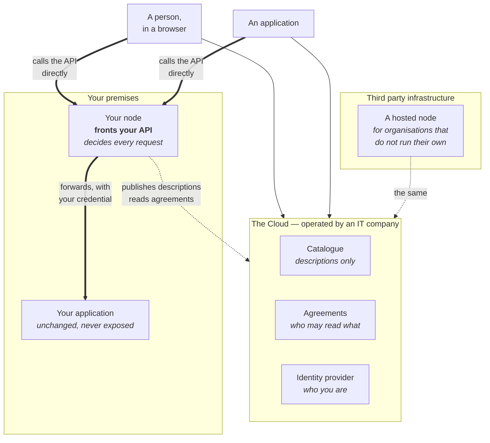

# The pieces

Two kinds of thing, and everything else supports them: **the Cloud**, which knows *what
exists and who agreed what*, and **nodes**, which front each organisation's applications
and data and decide who may call them.

Note what the arrows do **not** show: no line carries data into the Cloud, and no line
reaches your application except from your own node.

## The Cloud

Operated by IT partner. It holds three things and no data at all.

**The catalogue** — descriptions of everything published, searchable by anyone signed in.
For a service, the description says what it does and carries its **OpenAPI description**,
so a developer can see how to call it before asking for access. For a dataset, what it
covers and its licence. Both say where in the value chain they sit and which node to ask.
It never contains the data, and never the service itself.

**Agreements** — the record of who may call or read what, from when until when, and what
they may do with it. An agreement names an action: **invoke** a service, or **read** a
dataset. Requests, approvals, refusals and revocations all live here, and every change
is recorded with who made it and when.

**The identity provider** — who you are, which organisation you belong to, and whether
you may act for it. Everyone and everything on the platform authenticates here, including
the software.

If the Cloud goes down, nodes keep enforcing the agreements they already know about. They
carry on working from what they last read.

## A node

The part that puts an API in front of what you run, and holds what you store. One node can
serve several organisations, keeping each one's applications, credentials and records
separate.

A node does three jobs:

1. **Fronts your applications** so they can be called through the platform, and holds your
   datasets. Your application needs no CIRCULess-specific code and does not change.
2. **Publishes descriptions** of what you have chosen to make discoverable — descriptions
   only, and only what you marked.
3. **Decides every request**, on its own, against the agreements it has. Not the Cloud,
   not the network, not a gateway. If there is no agreement covering the request, it is
   refused and the refusal is recorded.

**Anything new is private by default.** A service or dataset you have just registered is
invisible outside your organisation until you deliberately change that. The quiet failure
a platform like this can have is publishing something nobody meant to publish, so the
default is closed.

### Where your node runs

**On your premises.** You control the machine. It needs **no inbound firewall ports** —
it connects outwards to an encrypted private network and everything reaches it through
that. Nothing of yours has to be exposed to the internet.

**On an IT company infrastructure.** For organisations that would rather not run one. A node
holding non-sensitive data only, and refusing anything classified as sensitive can be configured.
This node allows the possibility to try the platform without taking any privacy related risks.

## Services — the main thing the platform carries

A service is an application you already run — a calculation, a model, a lookup, an
optimiser — made callable by other organisations through the platform. This is what most
of the value in CIRCULess is: not files moving, but one partner's capability becoming
available to another's workflow.

**You do not expose it.** The node sits in front, and on every call it:

| | |
|---|---|
| **checks the agreement** | before anything is forwarded, and records the decision either way |
| **strips what the caller sent** | their token, cookies, and any header claiming to be from CIRCULess, so a caller cannot forge an identity |
| **attaches your credential** | the API key or token your application expects. The caller never sees it |
| **adds who is calling** | the subject, their organisation and the request id, so your application can log or vary its answer |
| **forwards, and streams the answer back** | unchanged |

From the caller's side it looks like any other request to the platform. From yours, the
only thing that can reach your application is your own node.

**What a service must provide.** An HTTP API, an OpenAPI description of it, a credential
the node can hold, and a statement of how it should be called — timeouts, whether it is
synchronous or submit-and-poll, maximum request size. No CIRCULess-specific code. The
full list is in the [integration requirements](../integrating-a-service/integration-requirements.md).

**Why a service is the stronger thing to offer.** A caller ends up with an answer, not
your model and not your data. Withdraw the agreement and the next call is refused —
there is nothing in their hands to take back. A dataset does not work that way: a file
already delivered stays delivered.

## The console

The web interface to the Cloud: search the catalogue, request access, approve and refuse
requests, offer access to someone who has not asked, and read the record of what has
happened. Nothing in it can be done that could not be done through the API.

## The private network

Nodes and the Cloud talk to each other over an encrypted private network, which a node
joins by connecting outwards. Someone using a browser from an ordinary laptop is not on
that network, so a public gateway forwards their requests to the right node. **The
gateway forwards and nothing else** — it never decides whether a request is allowed. That
remains the node's job, every time.

---

Next: [how sharing works](how-data-gets-shared.md) — the pieces in motion, for a
service and for a dataset.
