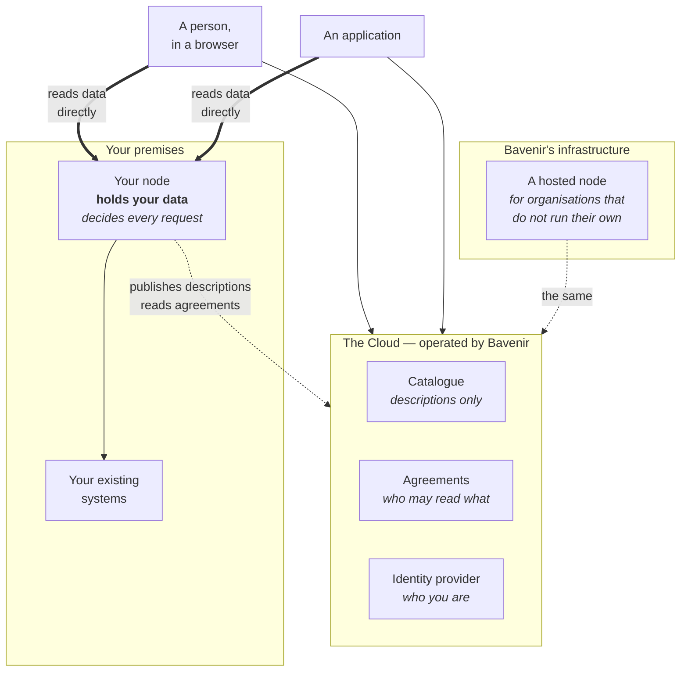

# The pieces

Two kinds of thing, and everything else supports them: **the Cloud**, which knows *what
exists and who agreed what*, and **nodes**, which hold the data and decide who may read
it.

Note what the arrows do **not** show: no line carries data into the Cloud.

## The Cloud

Operated by Bavenir. It holds three things and no data at all.

**The catalogue** — descriptions of everything published, searchable by anyone signed in.
A description says what a dataset covers, its licence, where in the value chain it sits,
and which node to ask. It never contains the data.

**Agreements** — the record of who may read what, from when until when, and what they may
do with it. Requests, approvals, refusals and revocations all live here, and every change
is recorded with who made it and when.

**The identity provider** — who you are, which organisation you belong to, and whether
you may act for it. Everyone and everything on the platform authenticates here, including
the software.

If the Cloud goes down, nodes keep enforcing the agreements they already know about. They
carry on working from what they last read, and say they are out of date rather than
guessing.

## A node

The part that actually holds data. One node can serve several organisations, keeping each
one's data, credentials and records separate.

A node does three jobs:

1. **Holds** your datasets, and fronts your existing services so they can be called
   through the platform.
2. **Publishes descriptions** of what you have chosen to make discoverable — descriptions
   only, and only what you marked.
3. **Decides every request**, on its own, against the agreements it has. Not the Cloud,
   not the network, not a gateway. If there is no agreement covering the request, it is
   refused and the refusal is recorded.

**New data is private by default.** Something newly added is invisible outside your
organisation until you deliberately change that. The quiet failure a platform like this
can have is publishing something nobody meant to publish, so the default is closed.

### Where your node runs

**On your premises.** You control the machine. It needs **no inbound firewall ports** —
it connects outwards to an encrypted private network and everything reaches it through
that. Nothing of yours has to be exposed to the internet.

**On Bavenir's infrastructure.** For organisations that would rather not run one. It
holds non-sensitive data only, and refuses anything classified as sensitive — not because
it is less secure, but because Bavenir holding a partner's sensitive data is an
arrangement the project undertook not to make.

## Services

A service is an application you already run — a calculation, a model, a lookup — made
callable through the platform.

You do not expose it. The node sits in front: it checks the agreement, strips whatever the
caller sent, attaches your credential, and forwards the call. The caller never sees the
credential and never reaches your service directly. From their side it looks like any
other request to the platform; from your side the only thing that can reach your service
is your node.

## The console

The web interface to the Cloud: search the catalogue, request access, approve and refuse
requests, offer access to someone who has not asked, and read the record of what has
happened. Nothing in it can be done that could not be done through the API — it is a
front end, not a privileged path.

## The private network

Nodes and the Cloud talk to each other over an encrypted private network, which a node
joins by connecting outwards. Someone using a browser from an ordinary laptop is not on
that network, so a public gateway forwards their requests to the right node. **The
gateway forwards and nothing else** — it never decides whether a request is allowed. That
remains the node's job, every time.

---

Next: [how data gets shared](how-data-gets-shared.md) — the pieces in motion.
